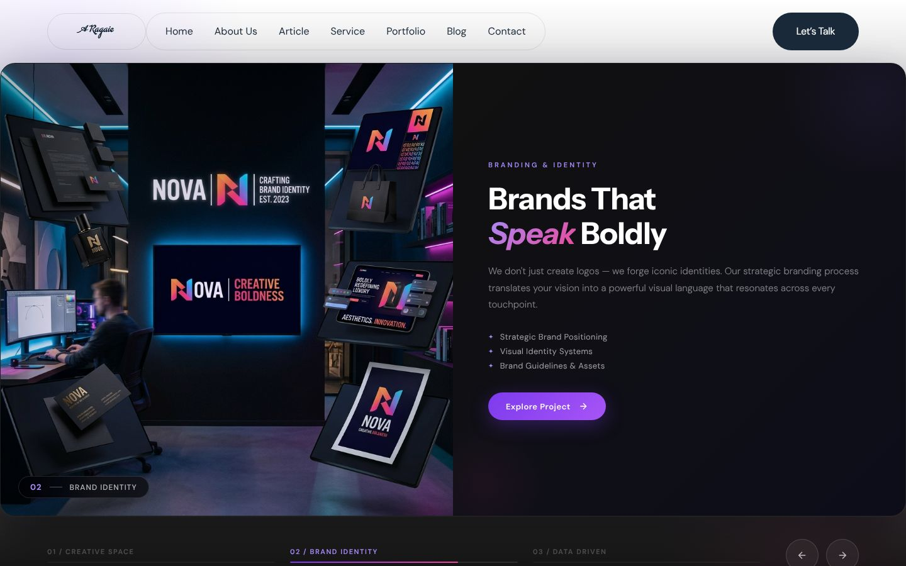
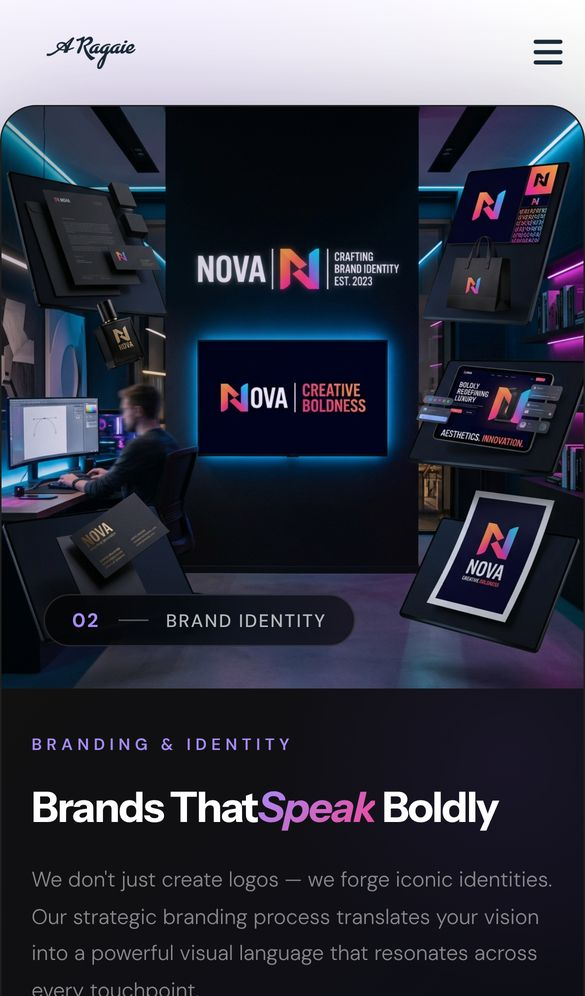
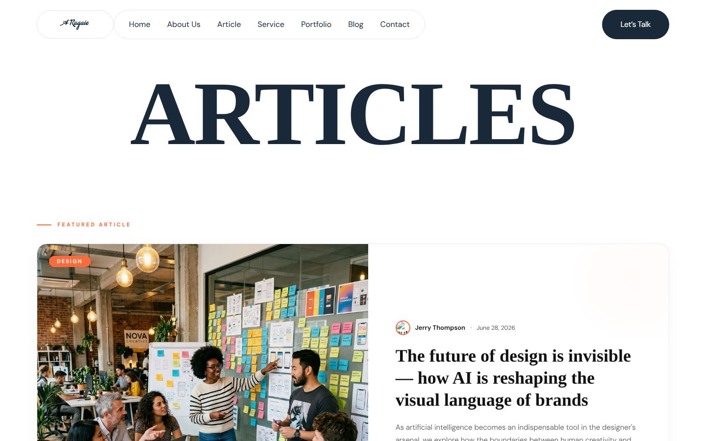

<div align="center">

# Ragaie – Company Profile

### Animated creative-agency company profile site in HTML, CSS and JavaScript

A multi-page company profile for the Ragaie brand (a design, development and marketing agency), with a full-screen showcase slider, GSAP scroll animations and a filterable articles section.

[](https://developer.mozilla.org/docs/Web/HTML)
[](https://sass-lang.com)
[](https://developer.mozilla.org/docs/Web/JavaScript)
[](https://getbootstrap.com)
[](https://gsap.com)
[](https://swiperjs.com)
[](https://jquery.com)
<br>
[](https://company-profile-tau-liard.vercel.app)

**[Live demo](https://company-profile-tau-liard.vercel.app)** ·
**[Portfolio](https://new-portfolio-ashy-xi.vercel.app/)** ·
**[LinkedIn](https://www.linkedin.com/in/eslamraafat-dev/)** ·
**[Email](mailto:eslamraafat736@gmail.com)**

<br>



</div>

<table>
  <tr>
    <td width="33%"></td>
    <td width="67%"></td>
  </tr>
  <tr>
    <td align="center"><sub>Mobile (iPhone 13)</sub></td>
    <td align="center"><sub>Articles page (<code>article.html</code>)</sub></td>
  </tr>
</table>

---

## Contents

- [Overview](#overview)
- [Features](#features)
- [Tech stack](#tech-stack)
- [Pages](#pages)
- [Project structure](#project-structure)
- [Getting started](#getting-started)
- [Deployment](#deployment)
- [Author](#author)

## Overview

Ragaie is a static company profile website for a creative agency. It is built on top of a premium agency HTML template (the SCSS and `main.js` come from that template), which I rebranded and extended with new sections and pages.

The copy, contact details (`(505) 555-0125`, `hello@Ragaieagency.com`) and article authors are placeholder content, so this is a design and front-end build rather than a launched client site.

What I worked on:

- Branding the template as Ragaie: logo, hero copy, services and footer across all pages.
- A **showcase slider** on the home page with its own stylesheet (`assets/css/showcase-slider.css`) and inline Swiper setup.
- Two new pages, **Articles** and **Article details**, with their own stylesheet (`assets/css/article.css`) and vanilla JavaScript.

## Features

### Home page

- Full-screen **showcase slider** (Creative Space · Brand Identity · Data Driven) with numbered progress tabs and previous / next buttons.
- **GSAP** animations: ScrollTrigger reveals, ScrollSmoother smooth scrolling, SplitText headings, and horizontally moving text and gallery rows.
- **Physics "client capsules"** that you can throw around, powered by matter.js (`data-t-throwable-scene`).
- Preloader, custom cursor (`magiccursor.js`), back-to-top progress circle and a MeanMenu mobile menu.
- Sections for about, video, work, services, fun facts, clients, CTA, productivity and the latest blog posts.

### Articles (`article.html`)

- Category filter (Design, Branding, Marketing, UX / Product, Technology, Strategy) and live search across article cards.
- Reading progress bar, hero parallax, floating particles, animated counters and card hover tilt.
- Reveal-on-scroll animations with `IntersectionObserver`, plus a newsletter form with client-side feedback.

### Article details (`article-details.html`)

- Reading progress bar, hero parallax and reveal animations.
- Share links, a comment form and a related-articles Swiper carousel.
- Header shadow that appears on scroll.

## Tech stack

| Layer | Tools |
| --- | --- |
| Markup | HTML5, 11 static pages |
| Styling | CSS3 compiled from SCSS (`assets/scss`), Bootstrap 5.2, Animate.css, Font Awesome 6.1 |
| Animation | GSAP 3.11 (ScrollTrigger, ScrollSmoother, ScrollToPlugin, SplitText, TextPlugin, CustomEase, Flip) |
| Sliders and UI | Swiper 8.2, Magnific Popup, MeanMenu, jQuery 3.7.1 |
| Physics | matter.js 0.19 with a throwable-elements helper |
| Hosting | Vercel |

## Pages

| Page | File |
| --- | --- |
| Home | `index.html` |
| About us | `about.html` |
| Articles | `article.html` |
| Article details | `article-details.html` |
| Services | `services.html` |
| Service details | `service-details.html` |
| Portfolio | `portfolio-4.html` |
| Portfolio details | `portfolio-details.html` |
| Blog | `blog.html` |
| Blog details | `blog-details.html` |
| Contact | `contact.html` |

## Project structure

```text
.
├── index.html, about.html, article*.html, services.html, …   # static pages
├── assets/
│   ├── css/
│   │   ├── style.css             # main theme stylesheet (compiled from scss/)
│   │   ├── showcase-slider.css   # home page showcase slider
│   │   └── article.css           # articles and article details pages
│   ├── scss/                     # components/, pages/, utils/ partials
│   ├── js/
│   │   ├── main.js               # theme scripts (GSAP, sliders, menus, preloader)
│   │   └── magiccursor.js        # custom cursor
│   ├── vendor/                   # Bootstrap, GSAP plugins, Swiper, jQuery, matter.js …
│   ├── imgs/                     # images, logos, icons
│   └── fonts/, webfonts/
└── docs/screenshots/             # README screenshots
```

## Getting started

No build step is needed.

```bash
git clone https://github.com/Eslamraafat1/company-profile.git
cd company-profile
npx serve .          # or open index.html in a browser
```

The `.scss` sources are included for reference; the site uses the compiled `assets/css/style.css`.

## Deployment

The site is deployed as a static site on **Vercel**: [company-profile-tau-liard.vercel.app](https://company-profile-tau-liard.vercel.app).

## Author

**Eslam Raafat** – Front-End Developer (React / Next.js / TypeScript)

- **Portfolio:** [new-portfolio-ashy-xi.vercel.app](https://new-portfolio-ashy-xi.vercel.app/)
- **LinkedIn:** [linkedin.com/in/eslamraafat-dev](https://www.linkedin.com/in/eslamraafat-dev/)
- **GitHub:** [@Eslamraafat1](https://github.com/Eslamraafat1)
- **Email:** [eslamraafat736@gmail.com](mailto:eslamraafat736@gmail.com)
